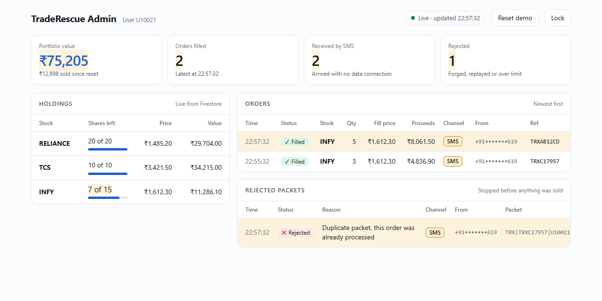

# TradeRescue — Firebase backend

Receives the emergency SMS (through a Twilio number), verifies the signed
packet, and executes the sell in Firestore.

```
Phone ── SMS ──► Twilio number ── webhook ──► Cloud Function `api` ──► Firestore
  ▲                                                │
  └────────── confirmation SMS ("SOLD 5 RELIANCE…") ┘
```

What the function checks before selling anything:

1. The HMAC signature matches (packet not forged or altered).
2. The packet is under 15 minutes old.
3. Its nonce and order ID have never been used (no replays).
4. The user holds enough shares, within the pre-authorized emergency limit.

Steps 3 and 4 and the update run in one Firestore transaction.

## What appears in Firestore

| Collection | Document | Contents |
|---|---|---|
| `users` | `U10021` | `holdings` map — the share quantities that drop when a sell executes |
| `orders` | the order ID, e.g. `TRX25517F` | symbol, quantity, fill price, proceeds, `channel` (`SMS`, `DIRECT`, `HTTP_FALLBACK`), sender's number, time |
| `nonces` | `U10021_<nonce>` | marks a packet as used |

## Endpoints

Base URL after deploy: `https://asia-south1-<project-id>.cloudfunctions.net/api`

| Method and path | Used by |
|---|---|
| `POST /webhook/twilio-sms` | Twilio, when an SMS arrives. Replies with the confirmation SMS. |
| `POST /emergency/sms` | The app's HTTP fallback (same packet as plain text). |
| `POST /order` | The app when online. |
| `GET /portfolio/U10021` | The app's dashboard. |
| `GET /admin/overview` | The admin dashboard. Needs the `x-admin-key` header. |
| `POST /demo/reset` | The dashboard's "Reset demo" button. Needs the admin key. Restores the portfolio and deletes orders and rejected packets. |

## Admin dashboard

`admin/index.html`, served by Firebase Hosting at
`https://<project-id>.web.app` after deploy. It refreshes every 2 seconds
and shows:

- portfolio value, orders filled, orders received by SMS, packets rejected
- each holding with shares left out of the starting amount
- every order: time, stock, quantity, fill price, channel, sender (masked)
- every rejected packet and the reason (forged, replayed, over limit)



It asks for the admin key on first open. The key is `demo-admin` unless
you set your own — **do that before deploying**: create `functions/.env`
containing `ADMIN_KEY=<something long and random>`. To skip typing it,
bookmark `https://<project-id>.web.app/#key=<your key>`.

The same site also serves the API under `/api`, so
`https://<project-id>.web.app/api` works as the app's Backend URL too.

## Run locally (no account, no cost)

```
cd firebase/functions
npm install
npm test
cd ..
firebase emulators:start --only functions,firestore,hosting --project demo-traderescue
```

Needs Java on PATH for the Firestore emulator (Android Studio's `jbr\bin`
works). Then:

- Admin dashboard: http://127.0.0.1:5000/#key=demo-admin
- API base URL: `http://127.0.0.1:5000/api`
- Raw database view: http://127.0.0.1:4000

## Demo without deploying (laptop + tunnel)

Twilio can only call a public URL. Without a cloud deploy, a tunnel gives
the backend running on your laptop a temporary public address:

```
Phone ── SMS ──► Twilio ──► https://<random>.trycloudflare.com ──► laptop:5000 ──► function + Firestore emulator
```

One command does all of it — starts the backend, opens the tunnel, and
sets the Twilio number's incoming-SMS webhook to the new address:

```
cd firebase
.\start-demo.ps1
```

It prints the dashboard link and the Backend URL to paste into the app.
The Twilio step runs only if `TWILIO_ACCOUNT_SID` and `TWILIO_NUMBER` are
set in the environment (the Auth Token is then asked for); with a second
phone in Gateway mode it is skipped. The address changes on every run, so
update the app's Backend URL each time. The laptop must stay on and
online for the whole demo. Orders are kept in `emulator-data/` between
runs.

## Second phone as the SMS gateway (no Twilio, no international SMS)

Any Android phone with a SIM can stand in for Twilio:

```
Phone A (offline) ── SMS ──► Phone B (Gateway mode, online) ──► POST /webhook/sms-forward ──► sell
        ▲                                │
        └──────── confirmation SMS ──────┘
```

On phone B: install the same app, set the Backend URL in ⚙ Settings, tap
Save, then reopen Settings and switch on **Gateway mode** and grant the
SMS permissions. On phone A: set the SMS number to phone B's number.

Phone B only forwards texts that start with `TRX|`; other messages are
ignored. It cannot forge or change an order, because the backend verifies
the packet's signature. `/webhook/sms-forward` accepts JSON
`{"from": "...", "text": "..."}`, so a third-party SMS-forwarding app
works too.

## Deploy

1. Create a Firebase project at https://console.firebase.google.com.
2. Upgrade it to the **Blaze** plan — Cloud Functions cannot be deployed on
   the free Spark plan. Demo usage stays inside the free allowance, but a
   billing card is required.
3. In the console: Build → Firestore Database → Create database
   (location `asia-south1`, production mode).
4. From this folder:
   ```
   firebase use --add          # pick the project
   firebase deploy --only functions,firestore:rules,hosting
   ```
5. Copy the function URL it prints, open it in a browser — you should see
   `{"service":"TradeRescue","status":"ok"}`.
6. In the app: ⚙ → Backend URL → paste that URL → Save. The dashboard
   should say "Live from server".

## Connect Twilio

1. Create a Twilio account and get a phone number that can **receive SMS**.
2. Phone Numbers → your number → Messaging → "A message comes in":
   Webhook, `POST`, `<function URL>/webhook/twilio-sms`.
3. In the app: ⚙ → SMS destination number → the Twilio number, with
   country code.
4. On a trial account, verify your own phone number in Twilio, or the
   confirmation reply will not be delivered.

Check before the demo: Twilio does not offer ordinary Indian numbers for
inbound SMS, so the number will most likely be a US one. Sending to it from
an Indian SIM is an international SMS — it costs a few rupees and some
prepaid plans block it. Send one test text first.

## Demo limits

- The signing secret is the shared demo constant. Set `SIGNING_SECRET` in
  `functions/.env` to change it (and change the app to match).
- `/order` and `/portfolio` are open to anyone with the URL. Fine for a
  demo; a real service would require a logged-in user.
- The admin dashboard is protected by one shared key, not per-person
  logins.
- The Twilio webhook does not verify Twilio's own request signature. The
  packet's HMAC is what authorizes an order, so a forged webhook call
  cannot sell anything without the key.
- Fills use the stored price; there is no market feed.
